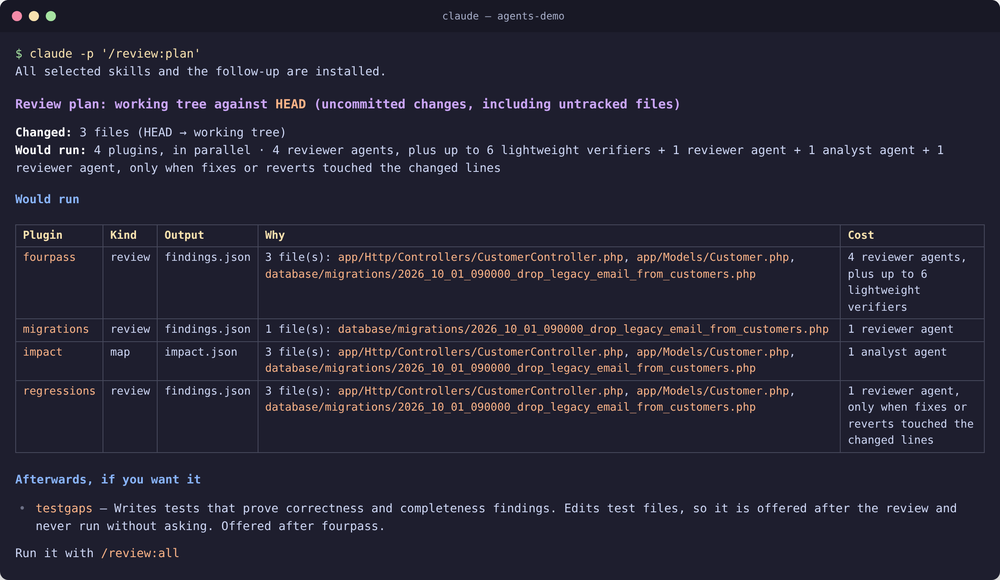
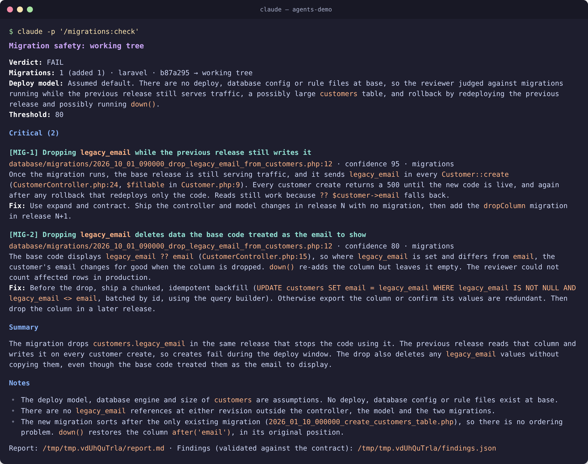
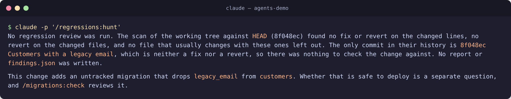
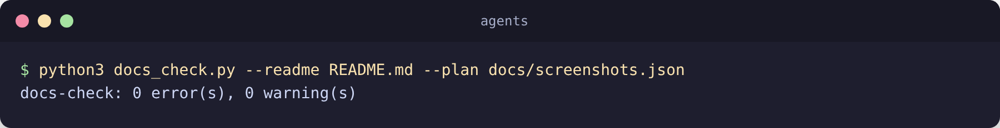
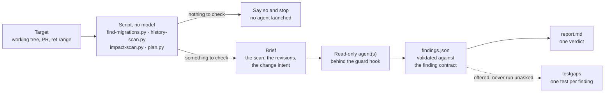
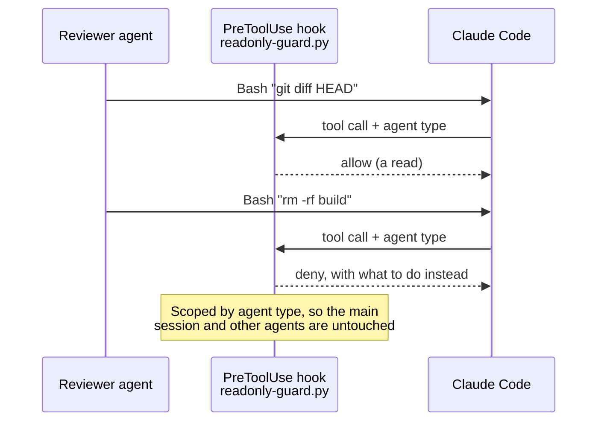
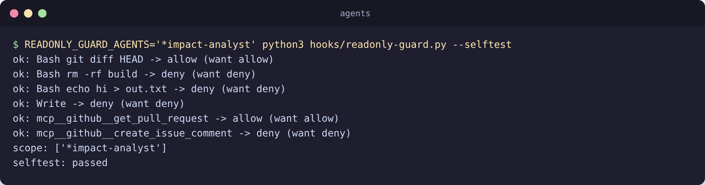
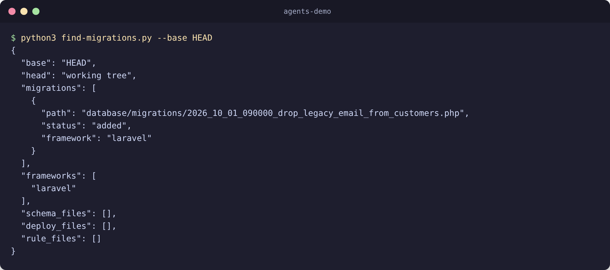
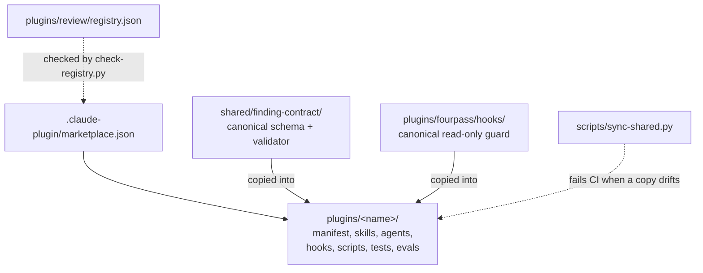
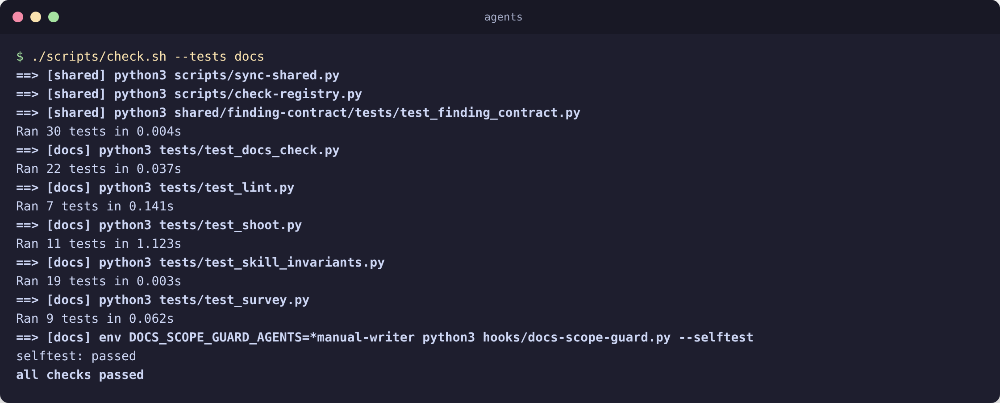

<h1 align="center">🧰 agents</h1>

<p align="center">
    <strong>Claude Code plugins that review a change before it ships, and document a project once it has.</strong><br>
    Parallel review passes, migration safety, regressions from git history, change-impact maps and tests from findings,<br>
    with read-only reviewers enforced by hooks, and scripts that launch nothing when there is nothing to check.
</p>

<p align="center">
    <a href="https://github.com/Jarryd-W-Hoffman/agents/actions/workflows/validate.yml"></a>
    
    
    
</p>

<p align="center">
    
</p>

<p align="center">
    <a href="#why-agents">Why agents?</a> ·
    <a href="#plugins">Plugins</a> ·
    <a href="#features">Features</a> ·
    <a href="#how-it-works">How it works</a> ·
    <a href="#installation">Installation</a> ·
    <a href="#usage">Usage</a> ·
    <a href="#how-its-built">How it's built</a> ·
    <a href="#development">Development</a> ·
    <a href="#licence">Licence</a>
</p>

---

## Why agents?

- **Nothing to check, nothing launched.** Every plugin runs a script first, with no model. A change with no migrations never starts the migration reviewer; a change whose lines no fix or revert ever touched never starts the regression reviewer; `/review:plan` picks plugins from file paths alone and costs nothing.
- **Read-only by enforcement, not by asking.** Reviewer agents run behind a PreToolUse hook that denies edits, state-changing shell commands and write-style MCP tools. The test writer can only touch test files, and the manual writer only Markdown under `docs/`. Each guard has a selftest that CI runs.
- **One finding shape across plugins.** Every reviewer writes `findings.json` in one [finding contract](shared/finding-contract/README.md), validated on the way out and on the way in, so `review` can merge them and `testgaps` can turn them into tests.
- **A review that did not happen is never a clean one.** If any selected pass or plugin fails to report, the verdict is `INCOMPLETE`, not `PASS`.
- **Runs on any `python3`.** The scripts and hooks are standard library only and support Python 3.9, because hooks run under whatever `python3` the user has and stock macOS is still on 3.9.

## Plugins

| Plugin | Command | What it does | Docs |
|---|---|---|---|
| `fourpass` | `/fourpass:review` | Reviews a change in four independent passes (completeness, correctness, compliance, consistency) run in parallel by read-only agents, and merges them into one ranked report. Can post it to a PR. | [README](plugins/fourpass/README.md) · [CHANGELOG](plugins/fourpass/CHANGELOG.md) |
| `migrations` | `/migrations:check` | Reviews database migrations for what breaks in production: the running release against the new schema during a deploy, table locks, data loss, constraints existing rows violate, missing rollbacks. Launches nothing when a change has no migrations. | [README](plugins/migrations/README.md) · [CHANGELOG](plugins/migrations/CHANGELOG.md) |
| `regressions` | `/regressions:hunt` | Checks whether a change undoes what the history already learned: a fix's guard removed, reverted code re-introduced, a regression test loosened, a usual partner file left behind. Launches nothing when the history has nothing to say. | [README](plugins/regressions/README.md) · [CHANGELOG](plugins/regressions/CHANGELOG.md) |
| `impact` | `/impact:map` | Maps what a change touches and what reaches it: callers, routes, scheduled tasks, queued jobs, event listeners, tests, data and contracts. Facts, not a review. | [README](plugins/impact/README.md) · [CHANGELOG](plugins/impact/CHANGELOG.md) |
| `testgaps` | `/testgaps:write` | Turns review findings into tests. One writer agent per finding writes the smallest test that proves it, runs it, and reports whether it reproduced the defect. A hook confines the writer to test files. | [README](plugins/testgaps/README.md) · [CHANGELOG](plugins/testgaps/CHANGELOG.md) |
| `review` | `/review:plan`, `/review:all` | Works out which of the plugins above a change needs, from the files it touches and with no model. `plan` shows that plan for free; `all` runs the selected plugins in parallel and merges their results into one report and one verdict. | [README](plugins/review/README.md) · [CHANGELOG](plugins/review/CHANGELOG.md) |
| `docs` | `/docs:readme`, `/docs:manual`, `/docs:screenshots` | Writes a README and a user manual in the shape of the [Kite](https://github.com/Jarryd-W-Hoffman/kite) repository: Mermaid diagrams of the real mechanism, pseudocode for the rules, and real screenshots taken from a plan kept in the repository. One writer agent per manual chapter, confined to `docs/` by a hook. Not part of `review`: it writes, it does not review. | [README](plugins/docs/README.md) · [CHANGELOG](plugins/docs/CHANGELOG.md) |

Each plugin's README is its manual: usage, output, configuration, and how to copy its pieces into a project without the plugin system.

## Features

### 🔎 Reviewing

- **Four passes in parallel:** `fourpass` asks four questions of a change, each in its own read-only agent, and merges the answers.

  | Pass | Question it answers |
  | --- | --- |
  | Completeness | Is everything that should be in this change actually here? |
  | Correctness | Does the code that is here behave as intended? |
  | Compliance | Does the change obey the written rules: CLAUDE.md, policies, ADRs, licences? |
  | Consistency | Does it fit the unwritten conventions of the code around it? |

- **Verified, ranked, postable:** findings between the threshold (80 by default) and 89, or reported differently by two passes, get a lightweight verifier each (up to 6). `--comment` posts the report to the pull request as one review, with an inline comment per finding.
- **Migrations against the deploy:** `migrations` judges each statement against three audiences: the old release still serving traffic while it runs, the new release, and a rollback. Laravel is the first-class case; it finds migrations in Rails, Django, Alembic, Flyway, Prisma, plain SQL and Node layouts too, and the deploy, locking and constraint checks apply to any of them.
- **History as a reviewer:** `regressions` reads the fixes and reverts that touched the changed lines with `git log -L` and checks the change against what each one established. Every finding names the earlier commit it rests on.

<p align="center">
    
</p>

### 🗺️ Mapping

- **What a change reaches:** `impact` finds the symbols a diff touches and every reference to them, then one read-only analyst drops name collisions and finds what grep cannot see: routes, the scheduler, event listeners, queued jobs, container bindings and policies.
- **Tests that reach it, and code none do:** the map lists both, plus the data and contracts the change touches, such as job payloads already serialized on the queue.
- **Facts, not findings:** no severities and no verdict. `--quick` gives the script's map alone, with no agent, marked unverified.

### 🧪 Proving

- **Findings become tests:** `testgaps` launches one `test-writer` per finding. Each writes the smallest test that proves it, in the repository's own conventions, runs it once, and reports what the result means:

  | Outcome | Meaning |
  | --- | --- |
  | `REPRODUCED` | The test fails on the current code for the reason the finding gives. |
  | `NOT_REPRODUCED` | It could not be made to fail; the finding or the test is wrong. |
  | `COVERED` | Behaviour a completeness finding called untested now has a passing test. |
  | `NOT_WRITTEN` | Nobody decided what the behaviour should be, so pinning it would be a liability. |
  | `BLOCKED` | The test could not run to a verdict. |

- **It cannot fix the code to pass:** a hook confines the writer to test paths and known test runners.

### 🎛️ Orchestrating

- **A plan for free:** `/review:plan` matches the changed files against each plugin's path patterns in `plugins/review/registry.json`. The same change always gets the same plan.
- **Everything at once:** `/review:all` runs the selected plugins in parallel, one subagent each, and merges their `findings.json` into one report and one verdict. Total time is the slowest plugin's, not the sum.
- **Nothing is skipped silently:** a plugin whose history has nothing to say says so and stops, without launching anything:

<p align="center">
    
</p>

### 📝 Documenting

- **READMEs and manuals in one shape:** `docs` writes them like Kite's, with diagrams of the real mechanism, pseudocode for the rules, and real screenshots. This README was written by following `/docs:readme`'s procedure and templates, and every image on it was taken by `plugins/docs/scripts/shoot.mjs` from [`docs/screenshots.json`](docs/screenshots.json).
- **Checked, not trusted:** `docs_check.py` fails on missing images and alt text, broken links and anchors, and malformed Mermaid diagrams.

<p align="center">
    
</p>

## How it works

Every review plugin has the same three parts: a skill that leads, a script that decides with no model whether there is anything to do, and one or more agents that do the reading.



- The script's output goes into the agent's brief, so the agent starts from facts and spends its time on judgement.
- An agent's JSON is validated against its contract before the report is rendered from it.
- `review` runs this whole pipeline once per selected plugin, in parallel, then merges.

### How `review` decides and merges

```text
plan:
  for each plugin in the registry:
    if a changed file matches one of its include patterns
       and none of its exclude patterns:
      select it, with the files that matched as evidence
  for each follow-up (testgaps):
    never select it; offer it after a plugin named in its "after" list

merge:
  for each selected plugin:
    if it is not installed, failed, or its findings.json breaks the contract
       or uses an id prefix the registry does not give it:
      mark it as not reported
  keep every finding as its plugin wrote it, under its original id
  list findings from different plugins on overlapping lines as overlaps
  if any selected plugin did not report:      verdict = INCOMPLETE
  else if any critical finding:               verdict = FAIL
  else if any major finding:                  verdict = REQUEST_CHANGES
  else if any minor finding:                  verdict = PASS_WITH_NOTES
  else:                                       verdict = PASS
```

Each plugin's include and exclude patterns mirror its own early stop, so the plan never selects a plugin that would then do nothing. `plugins/review/tests/test_plan.py` pins the selection for 20 change shapes, from docs only to a Prisma migration.

### The guards



- The guard reads the hook payload, finds the calling agent's type, and acts only for the agents its plugin names (`READONLY_GUARD_AGENTS='*impact-analyst'`).
- It fails closed: a command it cannot parse or classify, or an internal error, is denied.
- The canonical read-only guard lives in `plugins/fourpass/hooks/`; `migrations`, `impact` and `regressions` carry copies that `scripts/sync-shared.py` keeps identical.

<p align="center">
    
</p>

The scripts are useful on their own. Here `find-migrations.py` finds the one migration in the demo change, which is what decides whether `/migrations:check` launches its reviewer:

<p align="center">
    
</p>

## Installation

Add the repository as a marketplace once, then install whichever plugins you want:

```text
/plugin marketplace add /path/to/agents
/plugin install fourpass@jarrydh-agents
/plugin install migrations@jarrydh-agents
/plugin install regressions@jarrydh-agents
/plugin install impact@jarrydh-agents
/plugin install testgaps@jarrydh-agents
/plugin install review@jarrydh-agents
/plugin install docs@jarrydh-agents
```

To try a plugin for one session without installing it:

```bash
claude --plugin-dir /path/to/agents/plugins/fourpass
```

Restart Claude Code after installing. Each plugin's README covers how to copy its pieces into a project without the plugin system, and how to wire its guard by hand when you do.

## Usage

| Command | What it runs |
| --- | --- |
| `/review:plan` | Which plugins the working tree's change needs. No model, no agents. |
| `/review:all 214` | The plan for pull request #214, then every selected plugin in parallel, merged into one report. |
| `/fourpass:review main...feature/x` | The four passes on a ref range. Add `--comment` on a PR target to post the review. |
| `/migrations:check` | The migrations in the working tree, if there are any. |
| `/regressions:hunt 412` | Pull request #412 against its history. |
| `/impact:map --quick` | The impact map from the script alone. |
| `/testgaps:write review.md` | One test per correctness and completeness finding in a report. |
| `/docs:readme`, `/docs:manual` | This README's and a user manual's shape, for your project. |

Every review command takes a target: nothing (the working tree, or the branch against the default branch when the tree is clean), a pull request number or URL, or a ref range.

### Try it on the demo

The screenshots on this page were taken in a throwaway Laravel repository built from the migrations plugin's `dropped-column` fixture: a change that drops `customers.legacy_email` in the same release that stops using it.

```bash
docs/demo/make-demo-repo.sh                 # builds it in $TMPDIR/agents-demo and prints the path
docs/demo/run.sh '/review:plan'             # runs a prompt there, with every plugin loaded
docs/demo/run.sh '/migrations:check'        # one reviewer agent, about two minutes
```

## How it's built

| Layer | Technology |
| --- | --- |
| Plugins | [Claude Code plugins](https://docs.claude.com/en/docs/claude-code/plugins): skills that lead, subagents that read, PreToolUse hooks that guard |
| Scripts and hooks | Python 3.9+, standard library only |
| Contract | JSON Schema for `findings.json`, with a standard-library validator |
| Screenshots | Node 18+ and [Playwright](https://playwright.dev), in the `docs` plugin only |
| CI | GitHub Actions: `claude plugin validate --strict`, and the suites on Python 3.9 and 3.13 |



Each plugin is self-contained: an install copies only its own directory, so nothing in a plugin may read a file outside it. Code that several plugins need has one canonical copy, and `scripts/sync-shared.py` fails CI when a plugin's copy has drifted.

### Why this stack?

- **Standard-library Python** because hooks run under whatever `python3` the user already has, with no install step, and stock macOS still ships 3.9. A dependency would mean an install step for every user and in CI.
- **A script before every agent** because a decision a script can make (are there migrations? did a fix touch these lines? which plugins does this path need?) is free, instant and exactly testable. The model is kept for judgement.
- **Hooks as well as `disallowedTools`** because an instruction can be ignored and a hook cannot: a reviewer that tries to write gets a denial with a reason, and the selftests prove the wiring in CI.
- **Node for screenshots only** because Playwright is a Node library. `shoot.mjs` has no dependencies of its own and loads Playwright from the project being documented, so no plugin needs an `npm install`.

## Layout

```text
.claude-plugin/
  marketplace.json       lists every plugin under plugins/
plugins/
  fourpass/      one directory per plugin; see its README
  testgaps/
  migrations/
  impact/
  review/
  regressions/
  docs/
shared/
  finding-contract/      the findings.json schema every plugin reads and writes,
                         and its validator; canonical copy, see its README
scripts/
  check.sh               every check CI runs, for every plugin or one
  sync-shared.py         checks (or with --write, refreshes) each plugin's copy of shared/
  check-registry.py      checks the review plugin's registry against the marketplace
docs/
  screenshots.json       how every image in this README is taken
  demo/                  the throwaway repository the screenshots are taken in
SECURITY.md              reporting process and the threat model of the guards
CONTRIBUTING.md          repository-wide conventions; each plugin has its own
.github/                 CI, dependabot, issue and PR templates, screenshots
```

## Development

```bash
./scripts/check.sh                       # everything CI runs, every plugin
./scripts/check.sh fourpass              # one plugin
./scripts/check.sh --tests               # just the Python suites
./scripts/check.sh --manifests           # just manifest/component validation
```

`./scripts/check.sh` runs:
- `claude plugin validate --strict` on the marketplace, and on each plugin's manifest, agents and skills
- the shared checks: every copy matches its canonical file, the registry matches the marketplace, the finding contract's own tests
- every plugin's `tests/test_*.py`
- each guard's `--selftest`, with the scope its plugin's `hooks.json` actually registers

<p align="center">
    
</p>

CI runs the same script: manifests on one job, the suites on Python 3.9 and 3.13. If it passes locally, it passes there.

To retake the screenshots on this page after a change (needs `claude` signed in, Node and Playwright):

```bash
node plugins/docs/scripts/shoot.mjs docs/screenshots.json
```

### Contributing

Pull requests are welcome. Read [CONTRIBUTING.md](CONTRIBUTING.md), and the plugin's own `CONTRIBUTING.md` before touching a plugin.
- Sign off every commit (`git commit -s`): the repository checks the [Developer Certificate of Origin](https://developercertificate.org).
- Add an entry under `[Unreleased]` in the plugin's `CHANGELOG.md`.
- Run `./scripts/check.sh` before opening a PR.

Security issues: see [SECURITY.md](SECURITY.md).

## Licence

MIT, see [LICENSE](LICENSE).
