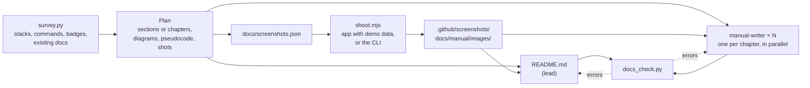

# docs

A Claude Code plugin that writes a project's README and user manual in the shape of the [Kite](https://github.com/Jarryd-W-Hoffman/kite) repository: a README with a centred hero, badges, a link row, features grouped with screenshots, an honest "why this stack", and a user manual with one chapter per feature, each with a Mermaid diagram of how it works, pseudocode for its rules, step-by-step instructions and real screenshots.

The screenshots are real: a script drives the running app (or runs the CLI) from a plan kept in the repository, `docs/screenshots.json`, so they can be retaken after every change, the way Kite's manual is.

| Piece | What it does |
|---|---|
| `readme` skill | Surveys the repository, plans the sections, diagrams, pseudocode and screenshots, takes the screenshots, writes `README.md`, and checks it. |
| `manual` skill | Plans the chapters, takes the screenshots, writes `docs/manual/README.md`, runs one `manual-writer` per chapter in parallel, checks the result, and links it from the README. |
| `screenshots` skill | Retakes every shot in the plan, or some, or adds a new one. |
| `manual-writer` agent | Writes one chapter from the code, confirming every statement, and reports what it could not confirm. Reads anything; writes Markdown under `docs/` and nothing else, enforced by a hook. No shell. |
| `survey.py` | No model. The project's name, GitHub slug, stacks and their commands, CI workflows with badges, licence, existing docs and images, and what there is to screenshot. |
| `shoot.mjs` | No model. Takes the screenshots in the plan with Playwright: pages (a login once, then actions, a whole window or one element, light or dark) and terminals (a real command's output, colours included, or drawn as Markdown, in a terminal window). |
| `docs_check.py` | No model. Every image exists and has alt text, every link and anchor resolves, every Mermaid diagram starts with a diagram type and balances its brackets, every chapter has a screenshot and a diagram and is in the index, every planned screenshot was taken. Warns on drift from the template. |

## How it works



```text
/docs:manual
  survey the repository                       (script, no model)
  plan the chapters: 01 Getting started first, Preferences last,
    one chapter per thing a user sets out to do, with its source files and shots
  add the shots to docs/screenshots.json
  start the app on a spare port with demo data in a throwaway database
  take the shots, open each one, retake the bad ones, stop the app
  write docs/manual/README.md (contents, conventions, how to retake the shots)
  for each chapter, in parallel:
    a manual-writer reads the code and writes NN-slug.md
    it lists what it could not confirm and what else should change
  repeat:
    run docs_check.py
    fix broken links and images; send a chapter missing its diagram back to its writer
  until there are no errors
  link the manual from the README
```

The template, the house style and the screenshot guide are in `references/`. They are Kite's README and manual, written down: section order, voice, how diagrams and pseudocode are drawn, how screenshots are framed and described.

## Status

`0.1.0`, early. `/docs:readme` and `/docs:screenshots` have been run end to end on this repository (see [Dogfooded](#dogfooded)). `/docs:manual` has not yet been run end to end: the `manual-writer` agents and the scope guard pass their tests and selftest, but have not yet written a real manual.

## Cost

- `/docs:readme` and `/docs:screenshots`: the session's model only, no agents.
- `/docs:manual`: one `manual-writer` agent per chapter, eight at a time. A sixteen-chapter manual is sixteen agents. Ask for some chapters (`/docs:manual links graph`) to write or redo only those.

## Requirements

- Python 3.9 or later, for the survey and the check.
- Node 18 or later and Playwright, for the screenshots. Playwright is taken from the project's `node_modules` if it has it; otherwise the skill installs `playwright-core` once outside the repository and points `DOCS_PLAYWRIGHT_DIR` at it. The browser is `$CHROME_PATH`, an installed Chrome or Chromium, or Playwright's own.

## Installation

```bash
claude --plugin-dir /path/to/agents/plugins/docs      # one session
```

```text
/plugin marketplace add /path/to/agents
/plugin install docs@jarrydh-agents
```

## Usage

```text
/docs:readme                         # write the README from the template
/docs:readme --update                # keep its structure, bring it up to date
/docs:readme --url http://127.0.0.1:8000   # the app is already running
/docs:manual                         # the whole manual
/docs:manual search graph            # only these chapters
/docs:screenshots                    # retake every shot
/docs:screenshots --add "the export dialog"
```

The scripts run on their own too:

```bash
python3 scripts/survey.py --root path/to/repo
python3 scripts/docs_check.py --root path/to/repo --readme README.md --manual docs/manual --plan docs/screenshots.json
node scripts/shoot.mjs docs/screenshots.json --root path/to/repo [--only a,b] [--check] [--cached]
```

## Dogfooded

The [agents README](../../README.md) was written with `/docs:readme`, and every image on it was taken by `shoot.mjs` from [`docs/screenshots.json`](../../docs/screenshots.json): real `claude -p` runs of the plugins in a demo repository, drawn as Markdown, and real script output.

## Rules it keeps

- **Nothing invented.** Every command, shortcut, default and limit comes from the code, a manifest or a command that was run. What cannot be confirmed is left out and reported.
- **Real screenshots only.** A shot that cannot be taken stays missing, and the check says so.
- **Your data and code are left alone.** Demo data goes in a throwaway database or a scratch copy. A change the docs need in the code (a `data-test` attribute, a demo seeder) is proposed, not made.
- **Writers write their chapter and nothing else.** `hooks/docs-scope-guard.py` lets a `manual-writer` edit Markdown under `docs/` and denies it everything else that writes, the shell and MCP tools.

## Not part of review

`/review:plan` and `/review:all` never run this plugin: it writes documentation on request and has nothing to say about a diff. `scripts/check-registry.py` lists it in `NOT_REVIEWERS` for that reason.
